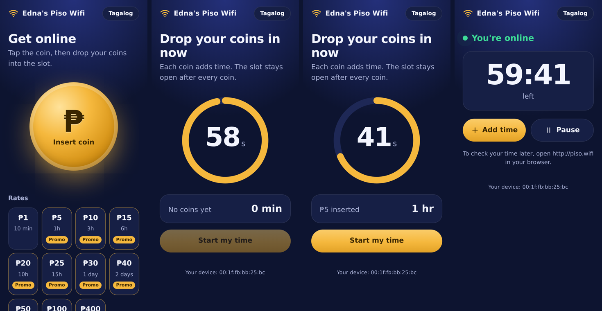
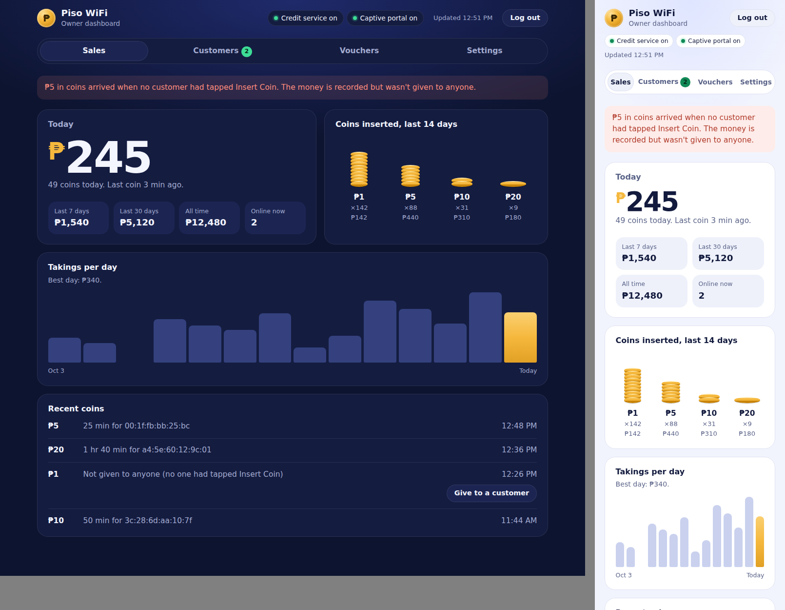
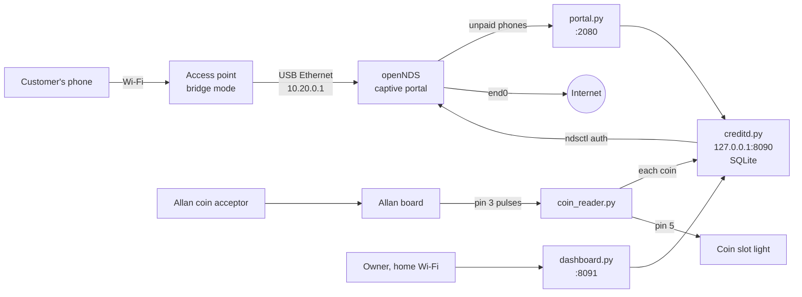
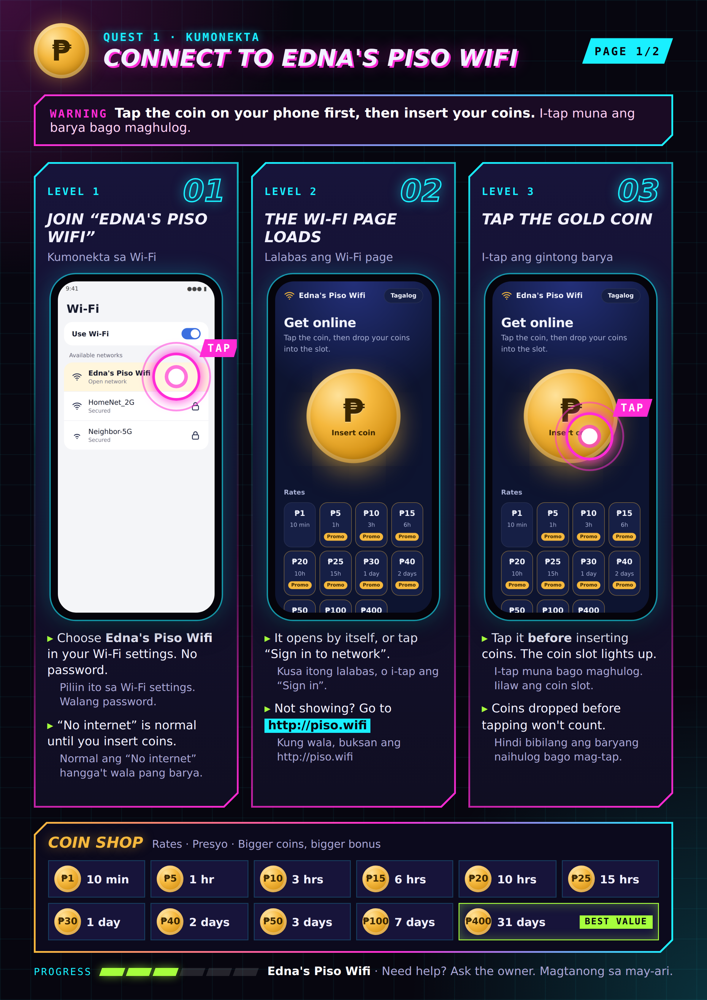
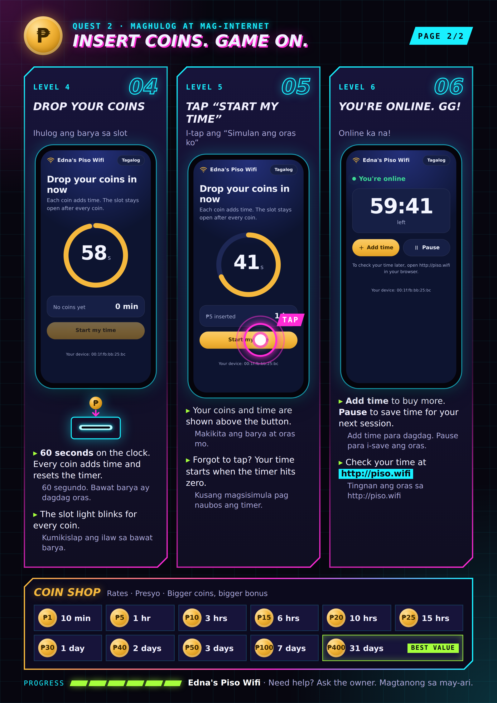
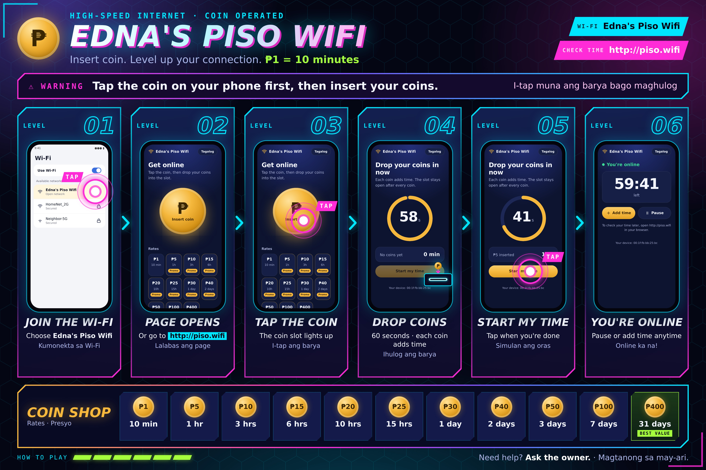

# Edna's Piso Wifi: open-source Piso WiFi for Orange Pi PC

[](https://github.com/shiroee/piso-wifi/actions/workflows/tests.yml)

A coin-operated Wi-Fi vending machine ("Piso WiFi") built on an **Orange Pi PC** running
**Armbian**, with **openNDS** as the captive portal and an **Allan** coin acceptor and
interface board. Customers join the Wi-Fi, tap the coin on their phone, drop coins in the
slot and get internet time. The owner watches sales and changes prices from a dashboard.



## Features

**For customers**
- Tap-the-coin portal with a live 60-second countdown; each coin shows up as it lands.
- Promo rates: bigger amounts get bonus time (₱1 = 10 min … ₱400 = 31 days).
- Pause and resume time; add time while online; vouchers.
- English or Tagalog; check time any time at `http://piso.wifi`.
- The coin slot lights up when it's ready and blinks for every coin.

**For the owner**
- Dashboard: today's takings, 7/30-day and all-time totals, coin mix, daily chart,
  connected phones, recent coins.
- Settings: rate, promos, Insert Coin timings, per-customer speed limit, the Piso WiFi
  name, dashboard theme.
- Printable vouchers; coins inserted before anyone tapped can be given to a customer.

**Under the hood**
- Every coin is written to disk before it's sent and recorded exactly once, so a crash,
  reboot or outage never loses or doubles a payment.
- Paid time comes back by itself after a reboot.
- Phones are identified by MAC from the ARP table; the admin token never leaves the Pi;
  admin ports are firewalled from customers.
- 160 automated tests, including real coin pulse captures from the machine.



## How it fits together



## Repository layout

| Path | What's in it |
|---|---|
| `app/` | `creditd.py`, the credit service: coins, Insert Coin windows, sessions, promos, vouchers, sales, settings |
| `coin/` | `coin_reader.py`: reads coin pulses on GPIO, drives the coin slot light |
| `portal/` | `portal.py`: the customer page openNDS sends phones to |
| `admin/` | `dashboard.py`: the owner dashboard |
| `systemd/` | Service files for all of the above, plus the firewall guard and NAT |
| `network/` | Firewall guard, and examples for netplan, dnsmasq, forwarding and NAT |
| `opennds/` | The `/etc/config/opennds` settings that work on Armbian |
| `config/` | `pisowifi.env.example`; `live/` for the machine's real settings (secrets removed) |
| `scripts/` | `install-deps.sh`, `update-code.sh`, `collect-live-config.sh` |
| `docs/` | Install guide, hardware, rates, operations, troubleshooting, API, test plan |
| `tools/print-materials/` | Regenerates the printed step pages and tarpaulin from the real portal |

## Getting started

1. Read [docs/hardware.md](docs/hardware.md) (parts, pins, safety).
2. Follow [docs/install-guide.md](docs/install-guide.md) from a blank SD card.
3. Set prices: [docs/rates.md](docs/rates.md).
4. Run through [docs/test-plan.md](docs/test-plan.md), then back up the SD card
   ([docs/operations.md](docs/operations.md)).

Already running? Update with `sudo bash scripts/update-code.sh` on the Pi.
Something wrong? [docs/troubleshooting.md](docs/troubleshooting.md).

## Running the tests

```sh
pip install flask
(cd coin && python -m unittest test_coin_reader)
(cd app && python -m unittest test_creditd)
(cd portal && python -m unittest test_portal)
(cd admin && python -m unittest test_dashboard)
```

GitHub Actions runs them on every push (`.github/workflows/tests.yml`).

## Printed materials

Step-by-step pages and a tarpaulin, generated from the real portal (edit
`tools/print-materials/config.py` and run `python make.py` to rebuild):

| Steps 1–3 | Steps 4–6 |
|---|---|
|  |  |



## Notes

- Never commit secrets: see [SECURITY.md](SECURITY.md).
- Not affiliated with LPB, Allan Auto Vending Solutions, openNDS, TP-Link or Xunlong
  (Orange Pi). Product names belong to their owners.
- MIT licensed: see [LICENSE](LICENSE).
